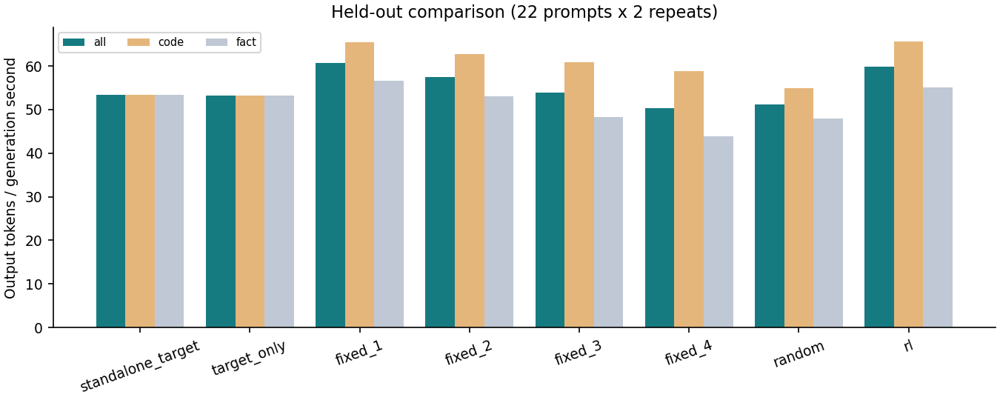
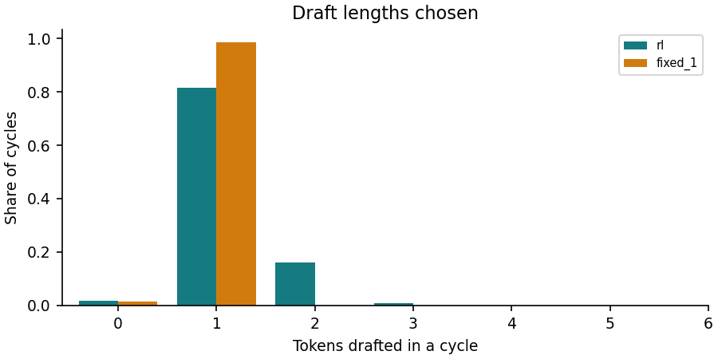

# Results: dev.tsv (22 prompts x 2 repeats)

Best fixed budget chosen on the training profile: **fixed_1**. Speed-up column is relative to **standalone_target**.

| Method | Tokens/s | Speed-up | code tok/s | fact tok/s | Mean draft | Acceptance | Same tokens as target |
| --- | ---: | ---: | ---: | ---: | ---: | ---: | ---: |
| standalone_target | 53.38 | 1.000x | 53.41 | 53.36 | 0.00 | - | 44/44 |
| target_only | 53.21 | 0.997x | 53.21 | 53.21 | 0.00 | - | 44/44 |
| fixed_1 | 60.71 | 1.137x | 65.38 | 56.62 | 0.99 | 0.76 | 44/44 |
| fixed_2 | 57.53 | 1.078x | 62.70 | 53.10 | 1.95 | 0.65 | 34/44 |
| fixed_3 | 53.83 | 1.008x | 60.81 | 48.24 | 2.90 | 0.59 | 34/44 |
| fixed_4 | 50.25 | 0.941x | 58.79 | 43.84 | 3.80 | 0.53 | 32/44 |
| random | 51.15 | 0.958x | 54.85 | 47.88 | 0.93 | 0.63 | 39/44 |
| **rl** | 59.89 | 1.122x | 65.60 | 55.03 | 1.16 | 0.74 | 42/44 |

RL / baseline throughput ratio (prompt-cluster bootstrap 95% interval):

| Baseline | Ratio | 95% interval |
| --- | ---: | --- |
| standalone_target | 1.122 | [1.075, 1.170] |
| target_only | 1.125 | [1.078, 1.174] |
| fixed_1 | 0.986 | [0.975, 0.997] |
| fixed_2 | 1.041 | [1.023, 1.060] |
| fixed_3 | 1.112 | [1.077, 1.157] |
| fixed_4 | 1.192 | [1.138, 1.244] |
| random | 1.171 | [1.148, 1.194] |

RL decisions that hit an unvisited state (fallback rule): 0.

Frozen greedy policy, no exploration or updates. Resident methods share one process and code path; randomized prompt/method order. Standalone target measured in a separate process without the draft model. Throughput = total output tokens / total generation wall seconds (prefill excluded).

