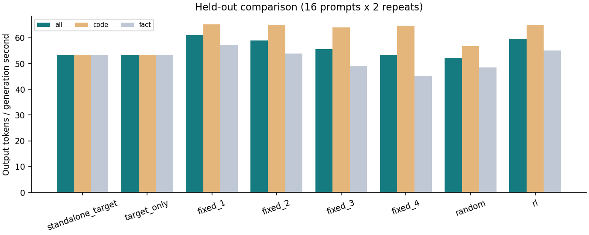
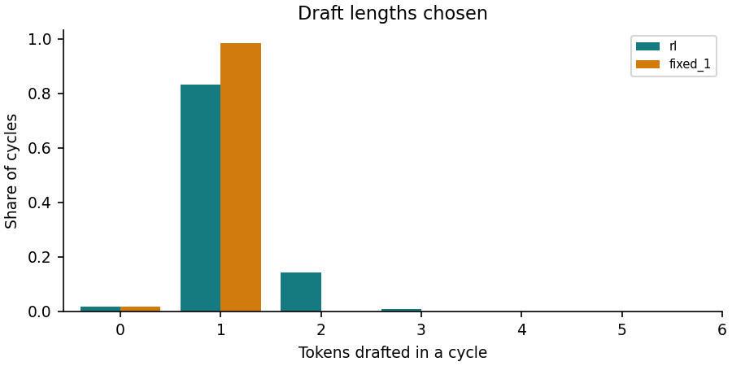

# Results: test.tsv (16 prompts x 2 repeats)

Best fixed budget chosen on the training profile: **fixed_1**. Speed-up column is relative to **standalone_target**.

| Method | Tokens/s | Speed-up | code tok/s | fact tok/s | Mean draft | Acceptance | Same tokens as target |
| --- | ---: | ---: | ---: | ---: | ---: | ---: | ---: |
| standalone_target | 53.27 | 1.000x | 53.30 | 53.24 | 0.00 | - | 32/32 |
| target_only | 53.25 | 1.000x | 53.25 | 53.25 | 0.00 | - | 32/32 |
| fixed_1 | 60.97 | 1.145x | 65.20 | 57.24 | 0.98 | 0.76 | 32/32 |
| fixed_2 | 58.98 | 1.107x | 65.07 | 53.92 | 1.96 | 0.69 | 30/32 |
| fixed_3 | 55.62 | 1.044x | 64.04 | 49.14 | 2.92 | 0.62 | 30/32 |
| fixed_4 | 53.25 | 1.000x | 64.75 | 45.20 | 3.80 | 0.57 | 30/32 |
| random | 52.26 | 0.981x | 56.68 | 48.47 | 0.93 | 0.66 | 29/32 |
| **rl** | 59.66 | 1.120x | 65.01 | 55.11 | 1.14 | 0.74 | 32/32 |

RL / baseline throughput ratio (prompt-cluster bootstrap 95% interval):

| Baseline | Ratio | 95% interval |
| --- | ---: | --- |
| standalone_target | 1.120 | [1.072, 1.171] |
| target_only | 1.120 | [1.073, 1.171] |
| fixed_1 | 0.979 | [0.959, 0.996] |
| fixed_2 | 1.011 | [0.994, 1.030] |
| fixed_3 | 1.073 | [1.038, 1.107] |
| fixed_4 | 1.120 | [1.053, 1.185] |
| random | 1.142 | [1.124, 1.159] |

RL decisions that hit an unvisited state (fallback rule): 0.

Frozen greedy policy, no exploration or updates. Resident methods share one process and code path; randomized prompt/method order. Standalone target measured in a separate process without the draft model. Throughput = total output tokens / total generation wall seconds (prefill excluded).

