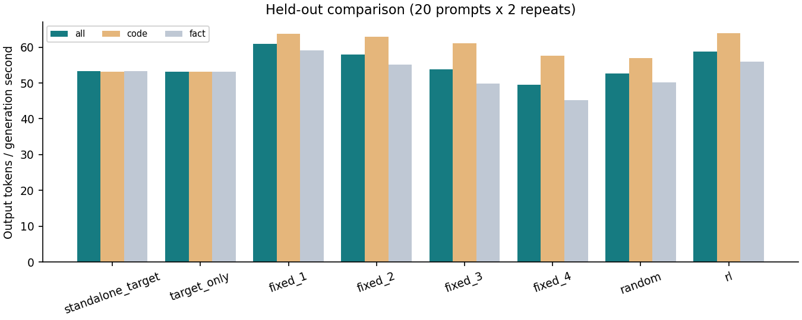
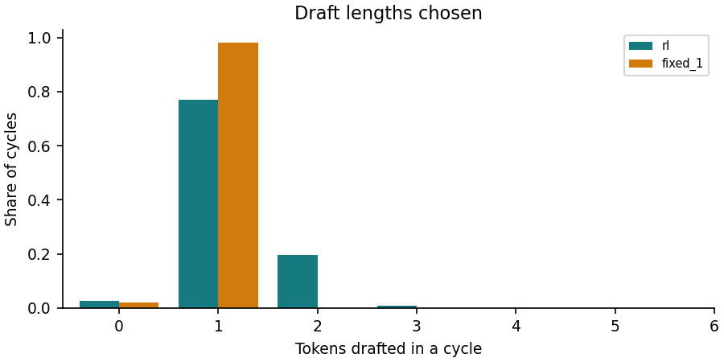

# Results: test_diverse.tsv (20 prompts x 2 repeats)

Best fixed budget chosen on the training profile: **fixed_1**. Speed-up column is relative to **standalone_target**.

| Method | Tokens/s | Speed-up | code tok/s | fact tok/s | Mean draft | Acceptance | Same tokens as target |
| --- | ---: | ---: | ---: | ---: | ---: | ---: | ---: |
| standalone_target | 53.26 | 1.000x | 53.23 | 53.27 | 0.00 | - | 40/40 |
| target_only | 53.20 | 0.999x | 53.21 | 53.19 | 0.00 | - | 40/40 |
| fixed_1 | 60.90 | 1.143x | 63.76 | 59.13 | 0.98 | 0.76 | 40/40 |
| fixed_2 | 58.03 | 1.090x | 62.94 | 55.16 | 1.94 | 0.67 | 32/40 |
| fixed_3 | 53.79 | 1.010x | 61.11 | 49.82 | 2.88 | 0.59 | 32/40 |
| fixed_4 | 49.45 | 0.928x | 57.62 | 45.17 | 3.81 | 0.52 | 32/40 |
| random | 52.62 | 0.988x | 56.93 | 50.09 | 0.93 | 0.67 | 34/40 |
| **rl** | 58.85 | 1.105x | 63.90 | 55.90 | 1.19 | 0.73 | 36/40 |

RL / baseline throughput ratio (prompt-cluster bootstrap 95% interval):

| Baseline | Ratio | 95% interval |
| --- | ---: | --- |
| standalone_target | 1.105 | [1.065, 1.153] |
| target_only | 1.106 | [1.065, 1.152] |
| fixed_1 | 0.966 | [0.944, 0.989] |
| fixed_2 | 1.014 | [0.989, 1.042] |
| fixed_3 | 1.094 | [1.057, 1.137] |
| fixed_4 | 1.190 | [1.142, 1.238] |
| random | 1.118 | [1.089, 1.149] |

RL decisions that hit an unvisited state (fallback rule): 0.

Frozen greedy policy, no exploration or updates. Resident methods share one process and code path; randomized prompt/method order. Standalone target measured in a separate process without the draft model. Throughput = total output tokens / total generation wall seconds (prefill excluded).

